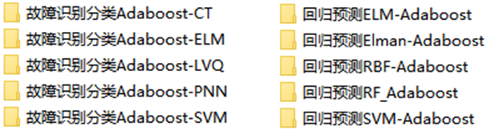
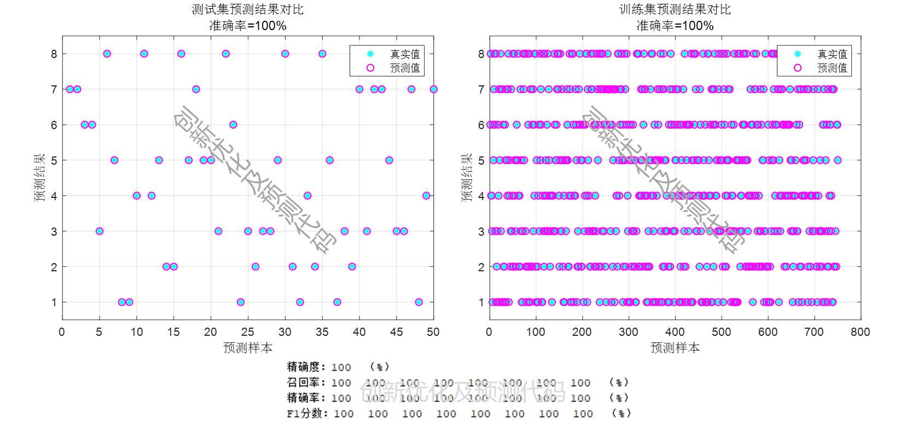
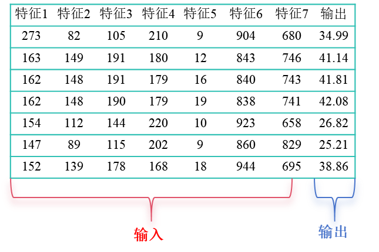
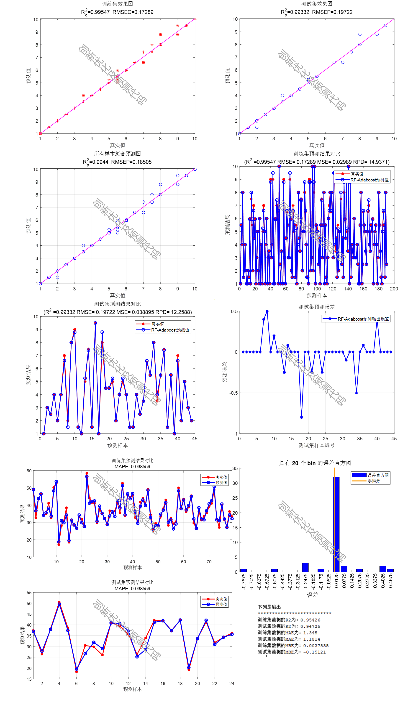

# Basic! Adaboost Regression/Classification Prediction Model Basic Edition, can be run without changing the code by replacing an Excel dataset! Clear Chinese comments are provided, suitable for beginners.

The program has been thoroughly tested and can be run by modifying the format according to the example data. The dataset is an Excel file.

Platform: Matlab2020 and above

Contents: Specific model types for classification and regression prediction:

Data format:

Classification model prediction results image:

Data format:

Regression image:

## Images

<!-- PAYMENT_BLOCK -->

## Get this dataset

- Payment link (Stripe): [Buy now](https://buy.stripe.com/3cs8yP7sY87d0vu9AB)
- Payment QR code: 

<!-- /PAYMENT_BLOCK -->
